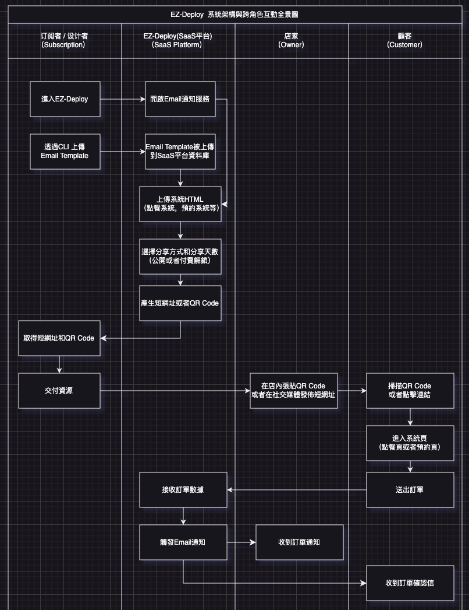

# EZ-Deploy Email Notification Demo

這是一個使用 EZ-Deploy Email Notification Service 的整合示範專案，包含 Email Template 管理 CLI、靜態點餐頁面，以及完整的手動部署與驗證文件。

本專案本身不包含 Email API 後端；後端服務由 EZ-Deploy 提供。你可以使用本專案完成以下流程：

1. 使用 `template_manage.sh` 上傳、查看與刪除 Email Template。
2. 使用 `demo/` 中的靜態點餐頁呼叫 Email Notify API。
3. 將點餐資料套用到 Email Template，寄送訂單確認信與店主通知副本。
4. 依照操作手冊與圖片完成本機測試及 EZ-Deploy 部署驗證。

## 專案內容

```text
EZ-Deploy-demo/
├── .env.local.example             # API 連線與金鑰設定範例
├── .env.owner.example             # Email Template 與店主設定範例
├── template_manage.sh             # Email Template 管理 CLI
├── demo/                          # 靜態點餐 demo 與 Email Template
├── imgs/                          # 架構、設定、部署與驗證截圖
└── docs/
    └── technique_report_manual.md # 完整操作與部署手冊
```

## 使用前準備

需要以下工具：

- Bash
- `curl`
- `jq`
- 可使用 Email Notification Service 的 EZ-Deploy 帳號

macOS 可使用 Homebrew 安裝 `jq`：

```bash
brew install jq
```

Windows 使用者建議透過 WSL + Ubuntu 執行 Bash Script。

## 設定環境變數

先複製兩份設定範例：

```bash
cp .env.local.example .env.local
cp .env.owner.example .env.owner1
```

### `.env.local`

`.env.local` 用來存放 API 連線資訊：

```bash
export API_BASE="https://your-api.example.com/"
export SITE_KEY="sk_pub_xxxxxxx"
export API_KEY="api_key_xxxxxxx"
```

- `API_BASE`：Email API 的基礎 URL。
- `SITE_KEY`：網站識別金鑰，可提供給前端使用。
- `API_KEY`：管理 Email Template 的私密金鑰，只能在本機 CLI 或伺服器環境使用。

### `.env.owner1`

`.env.owner1` 用來存放特定店家或系統的 Email Template 設定：

```bash
export TEMPLATE_ID="test_email"
export TEMPLATE_FILE="templates/test_email.html"
export TEMPLATE_FROM_NAME="店家名稱"
export TEMPLATE_OWNER_NOTIFY_EMAILS="owner@example.com"
export TEMPLATE_REPLY_TO_EMAIL="owner@example.com"
```

- `TEMPLATE_ID`：Email Template 的識別名稱。
- `TEMPLATE_FILE`：本機 Template 檔案路徑。
- `TEMPLATE_FROM_NAME`：信件寄件人顯示名稱。
- `TEMPLATE_OWNER_NOTIFY_EMAILS`：店主通知副本收件者，多個 Email 以逗號分隔，最多 5 個。
- `TEMPLATE_REPLY_TO_EMAIL`：信件回覆地址。

`template_manage.sh` 會自動從 Template 的 SUBJECT 與 BODY 區塊分析 `{variable_name}`，因此不需要手動設定 `ALLOWED_VARIABLES`。

> 請勿將實際的 `API_KEY`、私人收件地址或其他敏感資訊提交到 GitHub。`.env.local` 與 `.env.owner1` 應只存在於本機；GitHub 上只保留 `.env.local.example` 與 `.env.owner.example`。

載入設定：

```bash
source .env.local
source .env.owner1
```

## Email Template 格式

Template HTML 必須包含兩個獨立成行的區塊標記：

```html
<!-- SUBJECT -->
訂單確認 - {order_id}
<!-- /SUBJECT -->

<!-- BODY -->
<html>
  <body>
    <h1>您好，{customer_name}</h1>
    <p>訂單編號：{order_id}</p>
    <table>
      <tbody>
        {items_html}
      </tbody>
    </table>
    <p>訂單總額：{total}</p>
  </body>
</html>
<!-- /BODY -->
```

本專案的 `demo/templates/test_email.html` 使用以下變數：

| 變數 | 用途 |
| --- | --- |
| `{order_id}` | 訂單編號 |
| `{customer_name}` | 顧客姓名 |
| `{items_html}` | 訂單明細 HTML |
| `{total}` | 訂單總額 |

`{items_html}` 是前端將購物車資料組合成 `<tr>` 後傳入的 HTML 字串。

## 使用 `template_manage.sh`

### 驗證 API 金鑰並列出 Template

```bash
bash template_manage.sh list
```

### 上傳或更新 Template

在專案根目錄執行時，使用實際的 Template 路徑：

```bash
bash template_manage.sh test_email demo/templates/test_email.html
```

相同的 `TEMPLATE_ID` 再次上傳時會更新既有 Template。

也可以使用 `.env.owner1` 中的設定。此時請將 `TEMPLATE_FILE` 設為能從目前執行位置找到的路徑，例如：

```bash
export TEMPLATE_FILE="demo/templates/test_email.html"
bash template_manage.sh
```

### 取得單一 Template

```bash
bash template_manage.sh get test_email
```

### 刪除 Template

```bash
bash template_manage.sh delete test_email
```

### 查看說明

```bash
bash template_manage.sh --help
```

Template 管理請求會使用以下 Header：

- `X-Api-Key`
- `X-Site-Key`

請確認 `API_KEY` 只用於 `template_manage.sh`，不可寫入 `demo/test_order.html` 或其他會公開部署的前端檔案。

## 執行 demo

`demo/test_order.html` 是一個純 HTML/JavaScript 點餐頁面，會：

1. 讓顧客輸入姓名與 Email。
2. 加入餐點並計算總額。
3. 建立訂單編號與訂單明細。
4. 將資料送至 `/api/email/notify`。
5. 使用 Email Template 寄送訂單確認信。

開啟 `demo/test_order.html` 前，請編輯檔案中的 `CONFIG`：

```javascript
const CONFIG = {
  API_BASE: 'https://your-api.example.com',
  SITE_KEY: 'sk_pub_xxxxxxx',
  TEMPLATE_ID: 'test_email'
};
```

`TEMPLATE_ID` 必須與上傳到 EZ-Deploy 的 Template ID 完全一致。前端只需要使用公開的 `SITE_KEY`，**絕對不要將 `API_KEY` 放入 HTML 或 JavaScript**。

前端呼叫的 Payload 格式如下：

```json
{
  "template_id": "test_email",
  "to": "customer@example.com",
  "variables": {
    "order_id": "TEST-001",
    "customer_name": "王小明",
    "items_html": "<tr><td>雞腿堡</td><td>1</td><td>NT$95</td><td>NT$95</td></tr>",
    "total": "NT$95"
  }
}
```

本專案沒有提供本機 Email API 或 mock server。若要驗證 API 請求，可以依照操作手冊使用 `curl`，最後再將 demo 部署到 EZ-Deploy 進行完整的瀏覽器與寄信測試。

## 建議操作流程

```bash
# 1. 複製設定檔
cp .env.local.example .env.local
cp .env.owner.example .env.owner1

# 2. 編輯設定檔，填入自己的 API 與店家設定

# 3. 載入設定
source .env.local
source .env.owner1

# 4. 驗證連線
bash template_manage.sh list

# 5. 上傳或更新 demo Template
bash template_manage.sh test_email demo/templates/test_email.html

# 6. 編輯 demo/test_order.html 中的 CONFIG
# 7. 開啟或部署 demo/test_order.html
# 8. 完成下單，確認顧客與店主都收到信件
```

## 文件與圖片

完整的啟用服務、環境設定、Template 設計、API 測試、EZ-Deploy 部署與問題排查，請閱讀：

[Email 通知服務實戰指南](docs/technique_report_manual.md)

操作截圖與架構圖位於 [`imgs/`](imgs/)：



圖片內容包含：

- `architecture.png`：系統架構與角色互動
- `email_enable*`：啟用 Email Service 與取得金鑰
- `env-01.png`：環境準備
- `upload_template*`：Template 上傳
- `verify-*`：金鑰與 Template 驗證
- `local_test.png`：本機 API 測試
- `deploy-*`：EZ-Deploy 部署與 E2E 驗證

## 注意事項

- `API_KEY` 是私密管理憑證，不可放在前端或提交到公開 Repository。
- `SITE_KEY` 可用於前端識別，但仍建議只在環境設定與部署設定中管理實際值。
- 上傳前請確認 Template ID、Template 變數與 demo 使用的欄位名稱一致。
- `SUBJECT` 與 `BODY` 的開始、結束標記必須獨立成行，否則 CLI 無法正確解析。
- 本機測試可能因 `Origin` 或 `Referer` 不符合 EZ-Deploy 設定而回傳 `ORIGIN_NOT_ALLOWED` 或 `TENANT_MISMATCH`；正式部署後應從實際分享頁面進行 E2E 測試。
